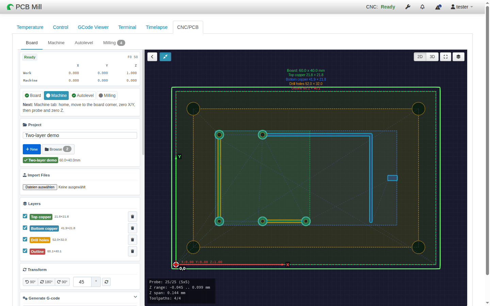
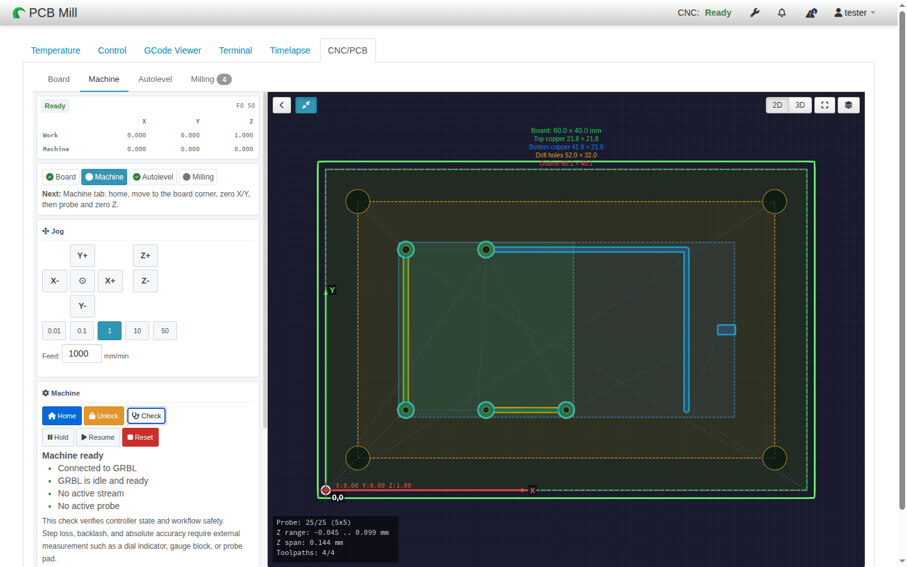
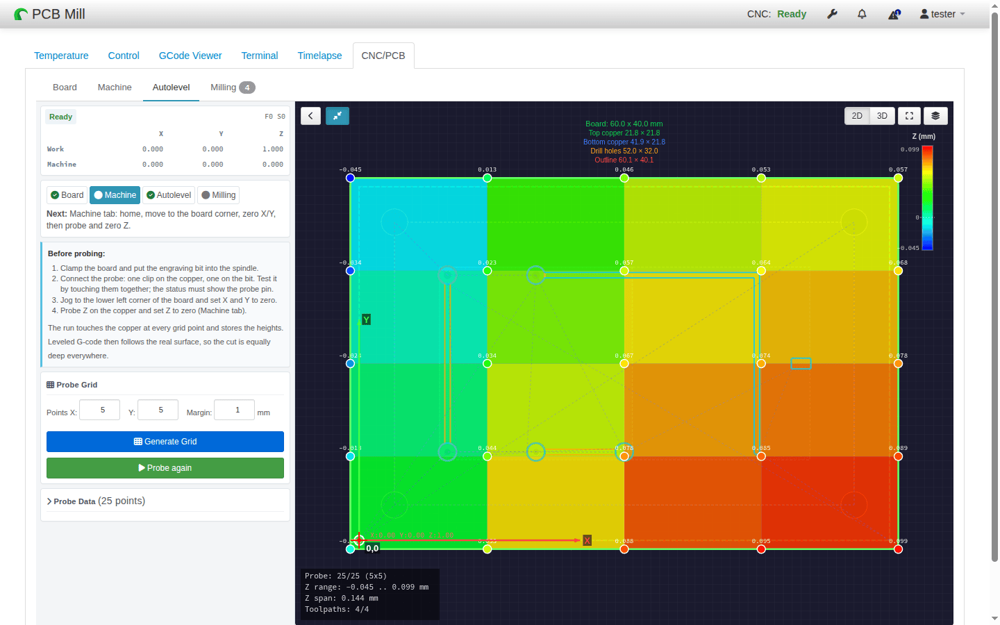
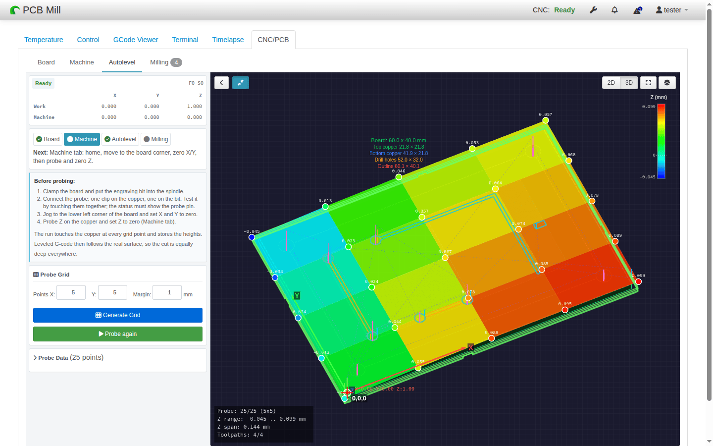
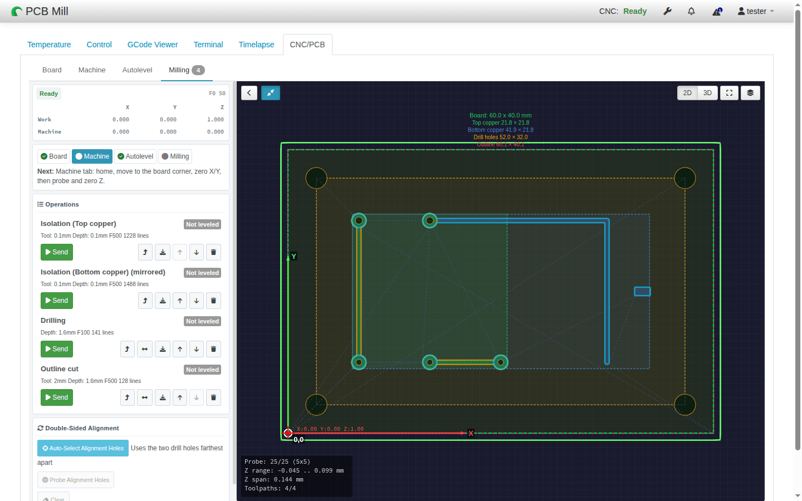
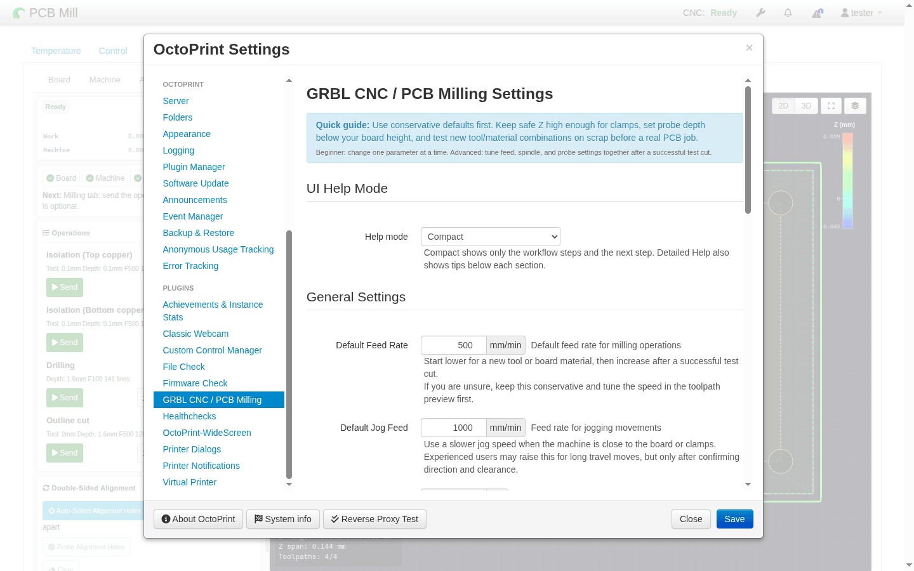

# OctoPrint-GrblPCB

Mill printed circuit boards on a GRBL CNC machine straight from OctoPrint.
Load the Gerber and Excellon files from your PCB tool, let the plugin compute
the toolpaths, probe the board surface, and send the jobs to the machine,
without an external CAM program.



> **Status: beta.** Every feature is covered by an automated test suite and
> has been run end to end against the GRBL simulator that ships with the
> plugin. It has **not yet been verified on a real machine**. Start with
> scrap material, keep a hand near the stop button, and see
> [Safety](#safety) before the first cut.

## Contents

- [Features](#features)
- [Requirements](#requirements)
- [Installation](#installation)
- [Getting started](#getting-started)
- [Double-sided boards](#double-sided-boards)
- [Settings](#settings)
- [Safety](#safety)
- [Testing without a machine](#testing-without-a-machine)
- [Development](#development)
- [License](#license)

## Features

**From Gerber to G-code**
- Gerber RS-274X: copper, outline (Edge.Cuts), solder mask; clear polarity,
  regions, aperture macros (including polygons and thermals), step-and-repeat
- Excellon drill files: metric and inch, leading and trailing zero
  suppression, incremental mode, `G85` slots
- Isolation milling with a V-bit: tool width from tip and angle, several
  overlapping passes, depth passes, climb milling, an extra pass for narrow
  gaps, and a warning with position for every gap the tool cannot open
- Drilling with peck cycles and a tool change for every drill size
- Outline cut on the centre line of the board edge, with holding tabs
- UV exposure paths for solder mask (laser or LED on the spindle)

**At the machine**
- Its own OctoPrint connection type for GRBL 1.1: streaming with GRBL's
  character-counting protocol, live position, feed hold, resume, soft reset,
  real-time overrides for feed, rapid and spindle
- Jogging, homing, work coordinate systems G54 to G59, zeroing, Z probing
  with "Probe Z and zero"
- Tool changes (`M6`) and program pauses (`M0`) stop the job and wait for a
  confirmation; afterwards the tool goes to safe Z before anything else moves
- Pre-flight checks before a job: Z zeroed, job within the machine travel,
  height map matching the clamped board

**Autolevel**
- Probe a grid over the board, see the surface as a coloured height map in
  2D and 3D, and apply it to any operation: the cut follows the real surface

**Double-sided boards**
- Bottom copper is generated mirrored for the flipped board
- Two drilled holes are probed after flipping; the plugin computes rotation
  and offset and corrects the back-side operations

**Interface**
- Workspace view in 2D and 3D with layers, holes, toolpaths and height map
- A workflow strip that shows what is done and what comes next
- English and German

## Requirements

- OctoPrint **2.0** or newer (the plugin uses the `ConnectedPrinter` API
  introduced in 2.0; it will not load on 1.x)
- Python 3.11 or newer
- A CNC machine running **GRBL 1.1** with a touch probe input (one clip on
  the copper, one on the bit) for probing and autolevel

## Installation

In OctoPrint open **Settings → Plugin Manager → Get More → from URL** and
enter:

```
https://github.com/andreashergert1984/OctoPrint-GrblPCB/archive/main.zip
```

Or install into OctoPrint's virtual environment from a shell:

```bash
source ~/oprint/bin/activate        # path to your OctoPrint venv
pip install https://github.com/andreashergert1984/OctoPrint-GrblPCB/archive/main.zip
```

Restart OctoPrint afterwards. The dependencies (pygerber, shapely, scipy,
numpy, pyserial) are installed automatically.

## Getting started

The plugin adds a **CNC/PCB** tab with four sub-tabs that follow the
workflow: **Board → Machine → Autolevel → Milling**. The strip at the top
always shows which steps are done and what to do next.

### 1. Connect

In OctoPrint's **Connection** panel choose the connection type
**GRBL CNC Connection** and the serial port of the machine, then click
**Connect**. (The type "Serial Connection" is for 3D printers and does not
work with GRBL.) If the machine has homing enabled it starts in alarm; the
red bar offers **Home All** and **Unlock**.

### 2. Board: import and generate


1. Click **New** and type a name for the project.
2. Under **Import Files** select all Gerber and drill files at once. The
   layer type is detected from the file name (KiCad, Eagle and most other
   tools work out of the box).
3. Check the board in the workspace. Rotate it in 90° steps or by any angle
   if it fits the stock better that way.
4. Open **Generate G-code**, check tool and cut settings, and create the
   operations: **Isolation (Top)**, **Isolation (Bottom)**, **Drilling**,
   **Outline**.

If the plugin finds gaps the tool cannot open, it says where they are.

### 3. Machine: home, zero, probe



1. **Home** the machine.
2. Jog to the lower left corner of the copper-clad board and click
   **X/Y=0**.
3. Connect the probe and click **Probe Z and zero**. The bit moves down until
   it touches the copper, Z is set to 0 there, and the bit lifts again.
4. **Check** shows whether the controller is ready.

### 4. Autolevel (optional, recommended)



Copper-clad boards are never perfectly flat, and a 0.1 mm isolation cut
notices. Choose the number of probe points and a margin, click
**Generate Grid**, then **Probe**. The plugin touches the copper at every
point and shows the result as a height map. In the 3D view you can see the
surface together with the toolpaths:



### 5. Milling



The operations are listed in order. For each one:

1. Click the **level** icon to apply the height map (the label changes from
   "Not leveled" to "Leveled").
2. Insert the tool the operation asks for, probe and zero Z.
3. Click **Send**. A pre-flight check warns if Z is not zeroed, if the job
   leaves the machine travel, or if the height map does not fit.

During the job you see progress, can pause, stop and adjust feed, rapid and
spindle overrides. At a tool change the job stops: change the bit, use
**Probe Z and zero** on the Machine tab, then click **Confirm Tool Change**.

**Send** is disabled with the reason in its tooltip when a job cannot start
(not connected, alarm, outdated operation).

## Double-sided boards

1. Mill the front side: top isolation, drilling, outline as needed.
   **Isolation (Bottom)** is always generated mirrored for the back side.
   For drilling and outline use the mirror button of the operation to get a
   back-side version.
2. In the Milling tab click **Auto-Select Alignment Holes**. The plugin picks
   two holes far apart that the probe can enter, and lists their positions.
3. Flip the board, clamp it, connect the probe.
4. Click **Probe Alignment Holes**. The bit is lowered into each hole with a
   probe move and touches the hole walls. The plugin then computes rotation
   and offset; a fit worse than 0.05 mm RMS is reported.
5. Apply the alignment to the mirrored operations and send them.

The workspace draws the back side as seen from the front, so copper and
toolpaths line up.

## Settings



**Settings → GRBL CNC / PCB Milling** holds the machine defaults: feed and
jog speed, safe Z height, probe travel and probe feed, V-bit tip diameter and
angle, spindle speed range and start-up delay, the default work coordinate
system, and the help mode (compact, or detailed explanations in every
section of the tab).

Everything that depends on the job, such as cut depth, passes and overlap,
drilling and outline parameters, and the probe grid, is set per project in
the **Generate G-code** panel and on the Autolevel tab.

## Safety

The plugin moves a machine with a spinning cutter. It was built to be
careful, but it has not been proven on real hardware yet.

- Test every new setup on scrap material first.
- Keep the stop button or the machine's emergency stop within reach.
  **Reset** in the plugin stops GRBL immediately; **Stop** holds the feed
  first so the position is kept.
- Make sure jog directions and the probe input work before the first job:
  touch the probe clips together and watch the probe pin in the status.
- After an alarm that loses the position (limit switch, reset during a move)
  the plugin forgets the Z zero; home and zero again.

## Testing without a machine

`tools/grbl_simulator.py` simulates a GRBL 1.1 controller on a pseudo
terminal: real-time commands, planner and RX buffer, status reports with
work offsets, probing against a slightly warped surface, drilled holes for
alignment tests, alarms.

```bash
python tools/grbl_simulator.py /tmp/ttyGRBL --homing --hole 56,4,3 --hole 4,36,3
```

Add the port under **Settings → Serial Connection → Additional serial ports**
(`plugins.serial_connector.additionalPorts`, a glob such as `/tmp/ttyGRBL*`
works); the GRBL connection then lists it. `--time-scale` sets how fast
moves run (default 0.05, i.e. 20 times faster than real time; use 1 for real
time).

A development container with OctoPrint and the simulator:

```bash
docker compose -f docker/docker-compose.yml up --build
```

Then open http://localhost:5000 and connect to `/tmp/ttyGRBL`.

## Development

```bash
git clone https://github.com/andreashergert1984/OctoPrint-GrblPCB.git
cd OctoPrint-GrblPCB
source /path/to/octoprint/venv/bin/activate
pip install -e .
python -m ruff check .
python -m pytest
```

The tests cover the Gerber and Excellon parser, toolpath geometry, G-code
accepted by the simulator, streaming, tool changes, probing, alignment,
permissions, the user interface structure and the translations.

After changing user-facing texts, update the German translation:

```bash
python setup.py babel_extract && python setup.py babel_refresh
# translate the new entries in translations/de/LC_MESSAGES/messages.po
python setup.py babel_compile && python setup.py babel_bundle --locale de
```

Project layout:

```
octoprint_grblpcb/
  __init__.py          plugin, API commands, probing runs
  connector.py         GRBL connection type and job streaming
  grbl_comm.py         serial protocol
  gerber_parser.py     Gerber and Excellon to geometry
  toolpath.py          geometry to G-code
  autolevel.py         height map and Z correction
  pcb_project.py       project data and storage
  static/ templates/   user interface
tools/grbl_simulator.py
tests/
docs/development-plan.md   status and open points
```

## License

[GNU Affero General Public License v3.0](LICENSE)

## Credits

- [OctoPrint](https://octoprint.org/) by Gina Häußge
- [pygerber](https://github.com/Argmaster/pygerber) and
  [Shapely](https://shapely.readthedocs.io/) for geometry
- Inspired by [octoprint-grbl-plugin](https://github.com/mic159/octoprint-grbl-plugin)
